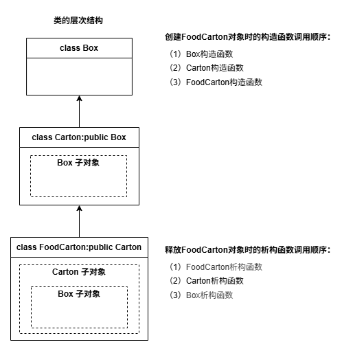
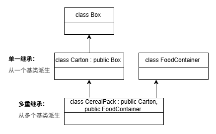
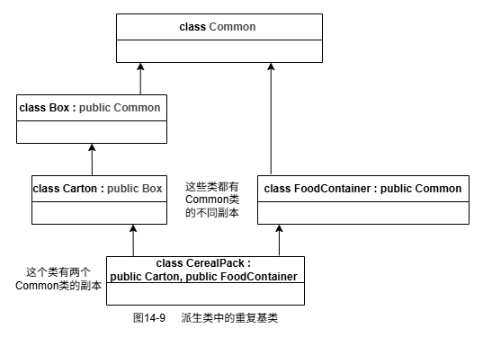

# 第14章 继承

## 14.1 类和面向对象编程

本章介绍“是”和“有”这两种关系如何用类来表示

**类层次结构**  

- class Box -> class Carton -> class FoodCarton
- UML是面积对象软件程序的可视化设计的事实标准

## 14.2 类的继承

- 基类（父类）：Carton类是FoodCarton类的直接基类；Box类是FoodCarton类的间接基类
- 派生类（子类）：派生类继承了基类的成员变量和成员函数，还有自己的成员变量和成员函数

### 14.2.1 继承和聚合

- 种类测试：任何派生类对象都是基类类型的对象
- 基类中是否有特性不能应用于派生类？
- 包含测试: automobile对象可以把engine对象、transmission对象和differential对象作为成员变量，这种关系称为聚合
    - 组合：House和Room的关系，Room不能脱离House存在
    - 聚合：Class和Student的关系，即使课程取消，学生也仍然存在

### 14.2.2 派生类

- 语法：派生类名:基类名 `export class Carton : public Box`
- 关键字public是**基类访问修饰符**，决定了基类成员如何在派生类中访问
- 案例Ex14_01
    - Box.cppm

        ```cpp
        // Box.cppm
        export module box;

        export class Box
        {
        public:
            Box() = default;
            Box(double length, double width, double height)
                : m_length{length}, m_width{width}, m_height{height} {}

            double volume() const { return m_length * m_width * m_height; }

            double getLength() const { return m_length; }
            double getWidth() const { return m_width; }
            double getHeight() const { return m_height; }

        private:
            double m_length{1.0};
            double m_width{1.0};
            double m_height{1.0};
        };
        ```

    - Carton.cppm

        ```cpp
        export module carton;

        import <string>;
        import <string_view>;
        import box;

        export class Carton : public Box
        {
        public:
            explicit Carton(std::string_view material = "Cardboard")
                : m_material{material} {}

        private:
            std::string m_material;
        };
        ```

    - Ex14_01.cpp

        ```cpp
        // Ex14_01.cpp
        import <iostream>;
        import box;
        import carton;

        int main()
        {
            Box box{40.0, 30.0, 20.0};
            Carton carton;
            Carton chocolateCarton{"Solid bleached board"}; // Good old SBB

            std::cout << "box occupies " << sizeof box << " bytes" << std::endl;
            std::cout << "carton occupies " << sizeof carton << " bytes" << std::endl;
            std::cout << "candyCarton occupies " << sizeof chocolateCarton << " bytes"
                        << std::endl;

            std::cout << "box's volume is " << box.volume() << std::endl;
            std::cout << "carton's volume is " << carton.volume() << std::endl;
            std::cout << "chocolateCarton's volume is " << chocolateCarton.volume() << std::endl;

            std::cout << "chocolateCarton's length is " << chocolateCarton.getLength() 
                        << std::endl;

            // Uncomment any of the following for an error...
            // box.m_length = 10.0;
            // chocolateCarton.m_length = 10.0;
        }
        ```

        以上程序运行结果如下：

        ---

        ```cpp
        box occupies 24 bytes
        carton occupies 64 bytes
        candyCarton occupies 64 bytes
        box volume is 24000
        carton volume is 1
        chocolateCarton volume is 1
        chocolateCarton length is 1
        ```

        ---

- 访问器函数是继承的，可供派生类对象调用
- 基类的成员变量如果是私有的，它们在派生类对象中仍然是私有的，不能在类的外部访问。基类和派生类以外都不能访问基类的private成员变量

## 14.3 把类的成员声明为protected

- 声明为protected的类成员不能在类的外部访问，但可以由声明为friend的函数访问
- 声明为protected的基类成员可以在派生类的成员函数中访问，而基类的私有成员则不能

## 14.4 派生类成员的访问级别

- 有3种基类访问修饰符：`public`、`protected`和`private`
- 默认的访问修饰符是`private`
- 一张表搞定访问权限规则如下（第一列是**基类成员自身的修饰符**，在基类中声明；
  后三列是**继承方式**，在派生类声明基类时指定）：

    | 基类成员修饰符 | public继承方式 | protected继承方式 | private继承方式 |
    | :---: | :---: | :---: | :---: |
    | public 成员 | 还是public | 变成protected | 变成private |
    | protected 成员 | 还是protected | 变成protected | 变成private |
    | private 成员 | 不可见 | 不可见 | 不可见 |

    - 成员修饰符：写在基类里，管的是"我自己的成员"
    - 继承方式：写在派生类里，管的是"我怎么接收基类的成员"

### 14.4.1 在类层次结构中使用访问修饰符

这节的核心内容就是教具体怎么写代码（纯语法）：

- 访问修饰符（public/protected/private）可以出现在两个地方
- 出现在类体内 → 修饰成员
- 出现在派生列表中 → 修饰继承方式
- 两者组合起来决定最终访问权限（就是那上面张表的内容）

### 14.4.2 在类层次结构中选择访问修饰符

这节主要教实际开发中该用哪个（设计决策）

- 关于成员修饰符的选择

    ```cpp
    class Base {
        // ✅ 首选 private：封装，不让外部乱改
        //    派生类也不能直接访问，只能通过 public 的 getter/setter
        int secret;

        // ⚠️ 选 protected：确实希望派生类能直接访问
        //    但外部不能访问。实际项目里很少用，因为会破坏封装
    protected:
        int data;

        // ✅ 选 public：就是给外部和派生类用的接口
    public:
        void setSecret(int v) { secret = v; }
        int getSecret() const { return secret; }
    };
    ```

- 关于继承方式的选择

    ```cpp
    // ✅ 几乎永远是 public 继承：
    // "Derived 是一种 Base"——是 is-a 关系
    class Dog : public Animal { };

    // ⚠️ protected 继承：极少用
    // 表示"我继承了，但不想让我的外部使用者知道"
    // 相当于把基类的 public 全变成 protected

    // ⚠️ private 继承：相当于"has-a"（组合）的替代
    // 表示"我用了 Base 的实现，但不想暴露任何接口"
    // 实际项目中几乎被组合（成员对象）取代
    class MyString : private std::string { }; // 不如直接用成员
    ```

### 14.4.3 改变继承成员的访问修饰符

使用using声明，可以把某个继承成员的访问状态恢复为基类的public

- 在对基类的成员名应用using声明时，必须用基类名限定成员名，因为这指定了成员名的上下文
- 不应该给函数提供参数列表或返回类型，仅提供成员函数的限定名即可
- using声明也被应用于派生类的继承成员变量
- 可以使用using声明重写基类中的public或protected基类访问修饰符。如，如果volume()函数在Box基类中是受保护成员，就可以在派生类Carton的public部分使用using声明，使它成员公共成员
- 不能把using声明应用于基类的私有成员
- 案例Ex14_01A
    - Ex14_01A.cpp

        ```cpp
        // Ex14_01A.cpp
        import <iostream>;
        import box;
        import carton;

        int main()
        {
            Box box{40.0, 30.0, 20.0};
            Carton carton;
            Carton chocolateCarton{"Solid bleached board"};

            std::cout << "box occupies " << sizeof box << " bytes" << std::endl;
            std::cout << "carton occupies " << sizeof carton << " bytes" << std::endl;
            std::cout << "candyCarton occupies " << sizeof chocolateCarton << " bytes" 
                        << std::endl;

            std::cout << "box volume is " << box.volume() << std::endl;
            std::cout << "carton volume is " << carton.volume() << std::endl;
            std::cout << "chocolateCarton volume is " << chocolateCarton.volume() << std::endl;

            // std::cout << "chocolateCarton length is " << chocolateCarton.getLenth() 
            // << std::endl; // "getLenth": 不是 "Carton" 的成员

            // box.m_length             = 10.0; // “Box::m_length”: 无法访问 private 成员(在“Box”类中声明)
            // chocolateCarton.m_length = 10.0; // “Box::m_length”: 无法访问 private 成员(在“Box”类中声明)
        }
        ```

    - Box.cppm

        ```cpp
        // Box.cppm
        export module box;

        import <iostream>;

        export class Box
        {
        public:
            Box()
            {
                std::cout << "Box() called." << std::endl;
            }
            Box(double length, double width, double height)
                : m_length{length}, m_width{width}, m_height{height}
            {
                std::cout << "Box(a,b,c) called." << std::endl;
            }

            double volume() const { return m_length * m_width * m_height; }

            double getLength() const { return m_length; }
            double getWidth() const { return m_width; }
            double getHeight() const { return m_height; }

        private:
            double m_length{1.0};
            double m_width{1.0};
            double m_height{1.0};
        };
        ```

    - Carton.cppm

        ```cpp
        // Carton.cppm
        export module carton;

        import box;
        import <string_view>;
        import <string>;
        import <iostream>;

        export class Carton : private Box // 私有继承，则继承的所有成员都是私有
        {
        public:
            explicit Carton(std::string_view mat = "Cardboard") : m_material{mat}
            {
                std::cout << "Carton() called." << std::endl;
            }
            using Box::volume; // 声明Box::volume()为公有

        private:
            std::string m_material;
        };
        ```

        以上程序运行结果如下：

        ---

        ```cpp
        Box(a,b,c) called.
        Box() called.
        Carton() called.
        Box() called.
        Carton() called.
        box occupies 24 bytes
        carton occupies 64 bytes
        candyCarton occupies 64 bytes
        box volume is 24000
        carton volume is 1
        chocolateCarton volume is 1
        ```

        ---

## 14.5 派生类中的构造函数

- 派生类会先调用基类默认的无参构造函数
- 派生类构造函数必须且只能调用基类的一个构造函数（显式或隐式），不存在第三种选择
- 案例Ex14_02
    - Ex14_02.cpp

        ```cpp
        // Ex14_02.cpp
        import <iostream>;
        import carton;

        int main()
        {
            Carton carton1;
            std::cout << std::endl;
            Carton carton2{"White-lined chipboard"};
            std::cout << std::endl;
            Carton carton3{4.0, 5.0, 6.0, "PET"};
            std::cout << std::endl;
            Carton carton4{2.0, "Folding boxboard"};
            std::cout << std::endl;

            std::cout << "carton1 volume is " << carton1.volume() << std::endl;
            std::cout << "carton2 volume is " << carton2.volume() << std::endl;
            std::cout << "carton3 volume is " << carton3.volume() << std::endl;
            std::cout << "carton4 volume is " << carton4.volume() << std::endl;
            // std::cout << "Hello world!" << std::endl;
        }
        ```

    - Box.cppm

        ```cpp
        // Box.cppm
        export module box;

        import <iostream>;
        import <ostream>;
        import <format>;

        export class Box
        {
        public:
            Box()
            {
                std::cout << "Box() called.\n";
            }

            Box(double length, double width, double height)
                : m_length{length}, m_width{width}, m_height{height}
            {
                std::cout << "Box(double,double,double) called.\n";
            }

            Box(double side) : Box{side, side, side}
            {
                std::cout << "Box(double) called.\n";
            }

            double volume() const { return m_length * m_width * m_height; }
            double getLength() const { return m_length; }
            double getWidth() const { return m_width; }
            double getHeight() const { return m_height; }

        protected:
            double m_length{1.0};
            double m_width{1.0};
            double m_height{1.0};
        };

        export std::ostream& operator<<(std::ostream& stream, const Box& box)
        {
            return stream << std::format("Box({:.1f},{:.1f},{:.1f})",
                                        box.getLength(), box.getWidth(), box.getHeight());
        }
        ```

    - Carton.cppm

        ```cpp
        // Carton.cppm
        export module carton;

        import <string>;
        import <string_view>;
        import <iostream>;
        import box;

        export class Carton : public Box
        {
        public:
            Carton() { std::cout << "Carton() called.\n"; }

            explicit Carton(std::string_view material) : m_material{material}
            {
                std::cout << "Carton(string_view) called.\n";
            }

            Carton(double side,std::string_view material):Box(side),m_material{material}
            {
                std::cout << "Carton(double,string_view) called.\n";
            }

            Carton(double length,double width,double height,std::string_view material)
            :Box(length,width,height),m_material{material}
            {
                std::cout << "Carton(double,double,double,string_view) called.\n";
            }

        private:
            std::string m_material{"Cardboard"};
        };
        ```

        以上程序运行结果如下：

        ---

        ```cpp
        Box() called.
        Carton() called.

        Box() called.
        Carton(string_view) called.

        Box(double,double,double) called.
        Carton(double,double,double,string_view) called.

        Box(double,double,double) called.
        Box(double) called.
        Carton(double,string_view) called.

        carton1 volume is 1
        carton2 volume is 1
        carton3 volume is 120
        carton4 volume is 8
        ```

        ---

- 不能在派生类的构造函数的初始化列表中初始化基类的成员变量，即使这些成员变量是受保护的或公共的，也不能初始化
- 如果要显式地初始化继承的成员变量，可以在派生类的构造函数体中进行

### 14.5.1 派生类中的副本构造函数

- 案例Ex14_03
    - Ex14_03.cpp

        ```cpp
        // Ex14_03.cpp
        import <iostream>;
        import carton;

        int main()
        {
            Carton carton(20.0, 30.0, 40.0, "Expanded polystyrene");
            std::cout << std::endl;

            Carton cartonCopy(carton);
            std::cout << std::endl;

            std::cout << "Volume of carton is " << carton.volume() << std::endl
                    << "Volume of cartonCopy is " << cartonCopy.volume() << std::endl;
            // std::cout << "Hello world!" << std::endl;
        }
        ```

    - Box.cppm

        ```cpp
        // Box.cppm
        export module box;

        import <iostream>;
        import <ostream>;
        import <format>;

        export class Box
        {
        public:
            Box()
            {
                std::cout << "Box() called.\n";
            }

            Box(double length, double width, double height)
                : m_length{length}, m_width{width}, m_height{height}
            {
                std::cout << "Box(double,double,double) called.\n";
            }

            Box(double side) : Box{side, side, side}
            {
                std::cout << "Box(double) called.\n";
            }

            Box(const Box& box) : m_length{box.m_length}, m_width{box.m_width}, m_height{box.m_height}
            {
                std::cout << "Box copy constructor" << std::endl;
            }

            double volume() const { return m_length * m_width * m_height; }
            double getLength() const { return m_length; }
            double getWidth() const { return m_width; }
            double getHeight() const { return m_height; }

        protected:
            double m_length{1.0};
            double m_width{1.0};
            double m_height{1.0};
        };

        export std::ostream& operator<<(std::ostream& stream, const Box& box)
        {
            return stream << std::format("Box({:.1f},{:.1f},{:.1f})",
                                        box.getLength(), box.getWidth(), box.getHeight());
        }
        ```

    - Carton.cppm

        ```cpp
        // Carton.cppm
        export module carton;

        import <string>;
        import <string_view>;
        import <iostream>;
        import box;

        export class Carton : public Box
        {
        public:
            Carton() { std::cout << "Carton() called.\n"; }

            explicit Carton(std::string_view material) : m_material{material}
            {
                std::cout << "Carton(string_view) called.\n";
            }

            Carton(double side, std::string_view material) : Box(side), m_material{material}
            {
                std::cout << "Carton(double,string_view) called.\n";
            }

            Carton(double length, double width, double height, std::string_view material)
                : Box(length, width, height), m_material{material}
            {
                std::cout << "Carton(double,double,double,string_view) called.\n";
            }

            Carton(const Carton& carton) : Box{carton},m_material{carton.m_material}
            {
                std::cout << "Carton copy constructor" << std::endl;
            }

        private:
            std::string m_material{"Cardboard"};
        };
        ```

        以上程序运行结果如下：

        ---

        ```cpp
        Box(double,double,double) called.
        Carton(double,double,double,string_view) called.

        Box copy constructor
        Carton copy constructor

        Volume of carton is 24000
        Volume of cartonCopy is 24000
        ```

        ---

- 派生类副本构造函数要调用基类副本构造函数，并且把派生类对象作为实参  
`Carton(const Carton& carton) : Box{carton},m_material{carton.m_material}`

### 14.5.2 派生类中的默认构造函数

- 派生类默认构造函数通过调用基类的默认构造函数来构造对象，如果基类没有默认构造函数，或=delete,或默认构造函数在私有域，则派生类默认构造函数编译会报错
    - 案例Ex14_04
        - Ex14_04.cpp

            ```cpp
            // Ex14_04.cpp
            import carton;
            import <iostream>;

            int main()
            {
                Carton carton1;
                std::cout << std::endl;
                Carton carton2{4.0, 5.0, 6.0, "PET"};
                std::cout << std::endl;
                Carton carton3{2.0, "Folding boxboard"};
                std::cout << std::endl;

                std::cout << "carton1 volume is " << carton1.volume() << std::endl;
                std::cout << "carton2 volume is " << carton2.volume() << std::endl;
                std::cout << "carton3 volume is " << carton3.volume() << std::endl;
            }
            ```

        - Box.cppm

            ```cpp
            // Box.cppm
            export module box;

            import <iostream>;
            import <ostream>;
            import <format>;

            export class Box
            {
            public:
                Box()
                {
                    std::cout << "Box() called.\n";
                }

                Box(double length, double width, double height)
                    : m_length{length}, m_width{width}, m_height{height}
                {
                    std::cout << "Box(double,double,double) called.\n";
                }

                explicit Box(double side) : Box{side, side, side}
                {
                    std::cout << "Box(double) called.\n";
                }

                double volume() const { return m_length * m_width * m_height; }
                double getLength() const { return m_length; }
                double getWidth() const { return m_width; }
                double getHeight() const { return m_height; }

            protected:
                double m_length{1.0};
                double m_width{1.0};
                double m_height{1.0};
            };

            export std::ostream& operator<<(std::ostream& stream, Box& box)
            {
                stream << std::format("Box({:.1f},{:.1f},{:.1f})",
                                    box.getLength(), box.getWidth(), box.getHeight());
                return stream;
            }
            ```

        - Carton.cppm

            ```cpp
            // Carton.cppm
            export module carton;

            import box;
            import <string>;
            import <string_view>;
            import <iostream>;

            export class Carton:public Box
            {
            private:
                std::string m_material{"Cardboard"};

            public:
                Carton() = default;

                Carton(double side,std::string_view material):Box{side},m_material{material}
                {
                    std::cout << "Carton(double,string_view) called.\n";
                }

                Carton(double length,double width,double height,std::string_view material)
                :Box{length,width,height},m_material{material}
                {
                    std::cout << "Carton(double,double,double,string_view) called.\n";
                }
            };
            ```

            以上程序运行结果如下：

            ---

            ```cpp
            Box() called.
                                                                                          
            Box(double,double,double) called.
            Carton(double,double,double,string_view) called.
                                                                                          
            Box(double,double,double) called.
            Box(double) called.
            Carton(double,string_view) called.
                                                                                         
            carton1 volume is 1
            carton2 volume is 120
            carton3 volume is 8
            ```

            ---

- 移除Box类的默认构造函数
    - 案例Ex14_04A
        - Ex14_04A.cpp

            ```cpp
            // Ex14_04A.cpp
            import carton;
            import <iostream>;

            int main()
            {
                Carton carton1; // error C2280: “Carton::Carton(void) noexcept(false)”: 尝试引用已删除的函数
                std::cout << std::endl;
                Carton carton2{4.0, 5.0, 6.0, "PET"};
                std::cout << std::endl;
                Carton carton3{2.0, "Folding boxboard"};
                std::cout << std::endl;

                std::cout << "carton1 volume is " << carton1.volume() << std::endl;
                std::cout << "carton2 volume is " << carton2.volume() << std::endl;
                std::cout << "carton3 volume is " << carton3.volume() << std::endl;
            }
            ```

        - Box.cppm

            ```cpp
            // Box.cppm
            export module box;

            import <iostream>;
            import <ostream>;
            import <format>;

            export class Box
            {
            public:
                // Box()
                // {
                //     std::cout << "Box() called.\n";
                // }

                Box(double length, double width, double height)
                    : m_length{length}, m_width{width}, m_height{height}
                {
                    std::cout << "Box(double,double,double) called.\n";
                }

                explicit Box(double side) : Box{side, side, side}
                {
                    std::cout << "Box(double) called.\n";
                }

                double volume() const { return m_length * m_width * m_height; }
                double getLength() const { return m_length; }
                double getWidth() const { return m_width; }
                double getHeight() const { return m_height; }

            protected:
                double m_length{1.0};
                double m_width{1.0};
                double m_height{1.0};
            };

            export std::ostream& operator<<(std::ostream& stream, Box& box)
            {
                stream << std::format("Box({:.1f},{:.1f},{:.1f})",
                                    box.getLength(), box.getWidth(), box.getHeight());
                return stream;
            }
            ```

        - Carton.cppm

            ```cpp
            // Carton.cppm
            export module carton;

            import box;
            import <string>;
            import <string_view>;
            import <iostream>;

            export class Carton:public Box
            {
            private:
                std::string m_material{"Cardboard"};

            public:
                Carton() = default; 
                //“Carton::Carton(void) noexcept(false)”: 由于 基类“Box”不具备相应的 默认构造函数 或重载解决不明确，因此已隐式删除函数

                Carton(double side,std::string_view material):Box{side},m_material{material}
                {
                    std::cout << "Carton(double,string_view) called.\n";
                }

                Carton(double length,double width,double height,std::string_view material)
                :Box{length,width,height},m_material{material}
                {
                    std::cout << "Carton(double,double,double,string_view) called.\n";
                }
            };
            ```

            以上程序运行结果如下：编译失败，原因见注释

- 使用Box() = delete;
    - 案例Ex14_04B
        - Ex14_04B.cpp

            ```cpp
            // Ex14_04B.cpp
            import carton;
            import <iostream>;

            int main()
            {
                Carton carton1; // error C2280: “Carton::Carton(void) noexcept(false)”: 尝试引用已删除的函数
                std::cout << std::endl;
                Carton carton2{4.0, 5.0, 6.0, "PET"};
                std::cout << std::endl;
                Carton carton3{2.0, "Folding boxboard"};
                std::cout << std::endl;

                std::cout << "carton1 volume is " << carton1.volume() << std::endl;
                std::cout << "carton2 volume is " << carton2.volume() << std::endl;
                std::cout << "carton3 volume is " << carton3.volume() << std::endl;
            }
            ```

        - Box.cppm

            ```cpp
            // Box.cppm
            export module box;

            import <iostream>;
            import <ostream>;
            import <format>;

            export class Box
            {
            public:
                Box() = delete;

                Box(double length, double width, double height)
                    : m_length{length}, m_width{width}, m_height{height}
                {
                    std::cout << "Box(double,double,double) called.\n";
                }

                explicit Box(double side) : Box{side, side, side}
                {
                    std::cout << "Box(double) called.\n";
                }

                double volume() const { return m_length * m_width * m_height; }
                double getLength() const { return m_length; }
                double getWidth() const { return m_width; }
                double getHeight() const { return m_height; }

            protected:
                double m_length{1.0};
                double m_width{1.0};
                double m_height{1.0};
            };

            export std::ostream& operator<<(std::ostream& stream, Box& box)
            {
                stream << std::format("Box({:.1f},{:.1f},{:.1f})",
                                    box.getLength(), box.getWidth(), box.getHeight());
                return stream;
            }
            ```

        - Carton.cppm

            ```cpp
            // Carton.cppm
            export module carton;

            import box;
            import <string>;
            import <string_view>;
            import <iostream>;

            export class Carton : public Box
            {
            private:
                std::string m_material{"Cardboard"};

            public:
                Carton() = default; // “Carton::Carton(void) noexcept(false)”: 由于 基类 调用已删除或不可访问的函数“Box::Box(void)”，因此已隐式删除函数

                Carton(double side, std::string_view material) : Box{side}, m_material{material}
                {
                    std::cout << "Carton(double,string_view) called.\n";
                }

                Carton(double length, double width, double height, std::string_view material)
                    : Box{length, width, height}, m_material{material}
                {
                    std::cout << "Carton(double,double,double,string_view) called.\n";
                }
            };
            ```

            以上程序运行结果如下：编译失败，原因见注释

- 使Box() = default;成为私有函数
    - 案例Ex14_04C
        - Ex14_04C.cpp

            ```cpp
            // Ex14_04C.cpp
            import carton;
            import <iostream>;

            int main()
            {
                Carton carton1; // error C2280: “Carton::Carton(void) noexcept(false)”: 尝试引用已删除的函数
                std::cout << std::endl;
                Carton carton2{4.0, 5.0, 6.0, "PET"};
                std::cout << std::endl;
                Carton carton3{2.0, "Folding boxboard"};
                std::cout << std::endl;

                std::cout << "carton1 volume is " << carton1.volume() << std::endl;
                std::cout << "carton2 volume is " << carton2.volume() << std::endl;
                std::cout << "carton3 volume is " << carton3.volume() << std::endl;
            }
            ```

        - Box.cppm

            ```cpp
            // Box.cppm
            export module box;

            import <iostream>;
            import <ostream>;
            import <format>;

            export class Box
            {
            public:
                Box(double length, double width, double height)
                    : m_length{length}, m_width{width}, m_height{height}
                {
                    std::cout << "Box(double,double,double) called.\n";
                }

                explicit Box(double side) : Box{side, side, side}
                {
                    std::cout << "Box(double) called.\n";
                }

                double volume() const { return m_length * m_width * m_height; }
                double getLength() const { return m_length; }
                double getWidth() const { return m_width; }
                double getHeight() const { return m_height; }

            private:
                Box() { std::cout << "Box() called.\n"; } // 在私有域声明默认构造函数
                double m_length{1.0};
                double m_width{1.0};
                double m_height{1.0};
            };

            export std::ostream& operator<<(std::ostream& stream, Box& box)
            {
                stream << std::format("Box({:.1f},{:.1f},{:.1f})",
                                    box.getLength(), box.getWidth(), box.getHeight());
                return stream;
            }
            ```

        - Carton.cppm

            ```cpp
            // Carton.cppm
            export module carton;

            import box;
            import <string>;
            import <string_view>;
            import <iostream>;

            export class Carton : public Box
            {
            private:
                std::string m_material{"Cardboard"};

            public:
                Carton() = default; // “Carton::Carton(void) noexcept(false)”: 由于 基类 调用已删除或不可访问的函数“Box::Box(void)”，因此已隐式删除函数

                Carton(double side, std::string_view material) : Box{side}, m_material{material}
                {
                    std::cout << "Carton(double,string_view) called.\n";
                }

                Carton(double length, double width, double height, std::string_view material)
                    : Box{length, width, height}, m_material{material}
                {
                    std::cout << "Carton(double,double,double,string_view) called.\n";
                }
            };
            ```

            以上程序运行结果如下：编译失败，原因见注释

### 14.5.3 继承构造函数

- 可以在派生类中添加using声明，从直接基类中继承构造函数。继承的构造函数在派生类中被隐式定义，其效果等价于：初始化列表中调用基类对应的构造函数、函数体内没有显式语句的构造函数。
- using声明可以放在类内部的任何位置，不影响继承构造函数的访问修饰符
- 案例Ex14_05
    - Ex14_05.cpp

        ```cpp
        // Ex14_05.cpp
        import carton;
        import <iostream>;

        int main() {
            Carton cart;
            Carton cube{4.0};
            Carton copy{cube}; // 编译器隐式生成的副本构造函数，没有输出语句
            Carton carton{1.0, 2.0, 3.0};
            Carton cerealCarton(50.0, 30.0, 20.0, "Chipboard");
        }
        ```

    - Box.cppm

        ```cpp
        // Box.cppm
        export module box;

        import <ostream>;
        import <format>;
        import <iostream>;

        export class Box
        {
        public:
            Box() { std::cout << "Box() called.\n"; }

            Box(double length, double width, double height)
                : m_length{length}, m_width{width}, m_height{height} {
                std::cout << "Box(double,double,double) called.\n";
            }

            explicit Box(double side) : Box{side, side, side} {
                /*单参数！记得加explicit
                委托构造函数的用法*/
                std::cout << "Box(double) called.\n";
            }

            double volume() const { return m_length * m_width * m_height; }
            double getLength() const { return m_length; }
            double getWidth() const { return m_width; }
            double getHeight() const { return m_height; }

        protected:
            double m_length{1.0};
            double m_width{1.0};
            double m_height{1.0};
        };

        export std::ostream& operator<<(std::ostream& stream, const Box& box) {
            stream << std::format("Box({:.1f},{:.1f},{:.1f})",
                                box.getLength(), box.getWidth(), box.getHeight());
            return stream;
        }
        ```

    - Carton.cppm

        ```cpp
        // Carton.cppm
        export module carton;

        import box;
        import <string>;
        import <string_view>;
        import <iostream>;

        export class Carton : public Box
        {
            using Box::Box;

        public:
            Carton() = default;

            Carton(double length, double width, double height, std::string_view mat)
                : Box{length, width, height}, m_material{mat} { //此处指定基类构造函数
                std::cout << "Carton(double,double,double,string_view) called.\n";
            }

        private:
            std::string m_material{"Cardboard"};
        };
        ```

        以上程序运行结果如下：

        ---

        ```cpp
        Box() called. 
        Box(double,double,double) called. 
        Box(double) called. 
        Box(double,double,double) called.
        Box(double,double,double) called.
        Carton(double,double,double,string_view) called.
        ```

        ---

## 14.6 继承中的析构函数

- 对象的释放顺序与创建它们的顺序相反
- 案例Ex14_06
    - Ex14_06.cpp

        ```cpp
        // Ex14_06.cpp

        import carton;
        import <iostream>;

        int main()
        {
            Carton carton;
            Carton candyCarton{50.0, 30.0, 20.0, "SBB"};

            std::cout << "Volume of carton is " << carton.volume() << std::endl
                    << "Volume of candyCarton is " << candyCarton.volume() << std::endl;
        }
        ```

    - Box.cppm

        ```cpp
        // Box.cppm
        export module box;

        import <iostream>;
        import <format>;
        import <ostream>;

        export class Box
        {
        public:
            Box(double length, double width, double height)
                : m_length{length}, m_width{width}, m_height{height}
            {
                std::cout << "Box(double,double,double) called.\n";
            }

            explicit Box(double side) : Box{side, side, side}
            {
                std::cout << "Box(double) called.\n";
            }

            Box(const Box& box) : m_length{box.m_length}, m_width{box.m_width}, m_height{box.m_height}
            {
                std::cout << "Box copy constructor" << std::endl;
            }

            Box() { std::cout << "Box() called.\n"; }

            ~Box() { std::cout << "Box destructor" << std::endl; }

            double volume() const { return m_length * m_width * m_height; }
            double getLength() const { return m_length; }
            double getWidth() const { return m_width; }
            double getHeight() const { return m_height; }

        protected:
            double m_length{1.0};
            double m_width{1.0};
            double m_height{1.0};
        };

        export std::ostream& operator<<(std::ostream& stream, const Box& box)
        {
            stream << std::format("Box({:.1f},{:.1f},{:.1f})",
                                box.getLength(), box.getWidth(), box.getHeight());
            return stream;
        }
        ```

    - Carton.cppm

        ```cpp
        // Carton.cppm
        export module carton;

        import box;
        import <string>;
        import <string_view>;
        import <iostream>;

        export class Carton : public Box
        {
        public:
            Carton() { std::cout << "Carton() called.\n"; }

            explicit Carton(std::string_view material) : m_material{material}
            {
                std::cout << "Carton(string_view) called.\n";
            }

            Carton(double side, std::string_view material) : Box{side}, m_material{material}
            {
                std::cout << "Carton(double,string_view) called.\n";
            }

            Carton(double length, double width, double height, std::string_view material)
                : Box{length, width, height}, m_material{material}
            {
                std::cout << "Carton(double,double,double,string_view) called.\n";
            }

            /*
            // Copy constructor (wrong)
            Carton(const Carton& carton) : m_material{carton.m_material} // 未显式指定Box对象构造函数，会调用默认Box()
            {
                std::cout << "Carton copy constructor" << std::endl;
            }
            */

            // Copy constructor (correct)
            Carton(const Carton& carton) : Box{carton}, m_material{carton.m_material}
            {
                std::cout << "Carton copy structor" << std::endl;
            }

            ~Carton() { std::cout << "Carton destructor.Material = " 
                                << m_material << std::endl; }

        private:
            std::string m_material{"Cardboard"};
        };
        ```

        以上程序运行结果如下：

        ---

        ```cpp
        Box() called.
        Carton() called.
        Box(double,double,double) called.
        Carton(double,double,double,string_view) called.
        Volume of carton is 1
        Volume of candyCarton is 30000
        Carton destructor.Material = SBB
        Box destructor
        Carton destructor.Material = Cardboard
        Box destructor
        ```

        ---

- 派生类的析构函数先调用，再调用基类析构函数  


## 14.7 重复的成员变量名

如果基类和派生类有同名的成员变量，要在派生类的成员函数中访问基类成员变量，必须使用基类名限定成员名，示例代码如下：

```cpp
int Derived::total() const
{
    return m_value + Base::m_value;
}
```

## 14.8 重复的成员函数名

- 第一种情况：基类函数和派生类函数名称相同，但签名不同。派生类的成员函数会隐藏继承的同名函数，必须使用using声明，
引入基类的函数，才能在派生类同时使用这两个同名的函数。根据参数类型不同调用不同的函数。

    ```cpp
    class Base
    {
    public:
        void doThat(int arg);
        ...
    };

    class Derived: public Base
    {
    public:
        void doThat(double arg);
        using Base::doThat; // 将基类同名函数引入派生类作用域
        ...
    };

    // 使用两个同名函数
    Derived object; // 声明类对象
    object.doThat(2); // 参数为int，调用基类成员函数
    object.doThat(2.5); // 参数为double，调用派生类成员函数
    ```

- 第二种情况：两个函数的签名相同。使用类名作为基类函数的限定符，就可以区分继承函数和派生类函数

    ```cpp
    Derived object;
    object.Bass::doThat(3); // 调用基类函数
    ```

## 14.9 多重继承

- 单一继承：只有一个直接基类

    ```cpp
    class A { /* ... */ };                // A 是 C 的间接基类
    class B : public A { /* ... */ };     // B 是 C 的直接基类
    class C : public B { /* ... */ };
    ```

    ```cpp
        A
        |
        B
        |
        C
    ```

- 多重继承：派生类有多个直接基类

    ```cpp
    class A { /* ... */ };
    class B { /* ... */ };
    class C : public A, public B { };  // C 直接继承 A 和 B
    ```

    ```cpp
        A       B
         \     /
          \   /
            C
    ```

- 两者结合：菱形继承（钻石问题）

    ```cpp
    class A { public:int data; };    // 顶层基类（间接基类）
    class B : public A { };          // B 是 C 的直接基类
    class C : public A { };          // C 是 D 的直接基类
    class D : public B, public C { };// D 多重继承 B 和 C
    ```

    ```cpp
        A         ← 间接基类（爷爷）
       / \
      /   \
     B     C      ← 直接基类（父母）
      \   /
       \ /
        D         ← 派生类
    ```

    - 问题：D 中有两份 A 的 data（B 带一份，C 带一份），访问时必须用作用域限定

        ```cpp
        D d;
        d.B::data = 1;  // 通过 B 路径访问
        d.C::data = 2;  // 通过 C 路径访问
        ```

    - 解决：用关键字`virtual`虚继承

        ```cpp
        class B : virtual public A { };
        class C : virtual public A { };
        class D : public B, public C { };
        ```

### 14.9.1 多个基类

在类的头部，每个基类都在冒号后指定，用逗号隔开。每个基类都有自己的访问修饰符，省略修饰符就是默认`private`

```cpp
class CerealPack : public Carton, public FoodContainer
{
    ...
};
```



### 14.9.2 继承成员的模糊性

类继承成员（函数或变量）如果存在同名的情况，会导致模糊性问题。解决的方法有以下几种：

- 重新编写类，这是最理想的方案
- 限定函数名，详见案例Ex14_07
    - Ex14_07.app

        ```cpp
        // Ex14_07.cpp
        import <iostream>;
        import cereal;

        int main()
        {
            CerealPack cornflakes{8.0, 3.0, 10.0, "Cornflakes"};

            std::cout << "cornflakes volume is " << cornflakes.Carton::volume() << std::endl
                            // 通过::限定volume为Carton类函数，如果为cornflakes.volume()会报错
                    << "cornflakes weight is " << cornflakes.FoodContainer::getWeight() 
                            // 通过::限定getWeight为FoodContainer类函数，如果为cornflakes.getWeight()会报错
                    << std::endl;
        }
        ```

    - Box.cppm

        ```cpp
        // Box.cppm
        export module box;

        import <iostream>;
        import <ostream>;
        import <format>;

        export class Box
        {
        public:
            Box()
            {
                std::cout << "Box() called.\n";
            }

            Box(double length, double width, double height)
                : m_length{length}, m_width{width}, m_height{height}
            {
                std::cout << "Box(double,double,double) called.\n";
            }

            explicit Box(double side) : Box{side, side, side}
            {
                std::cout << "Box(double) called.\n";
            }

            double volume() const { return m_length * m_width * m_height; }
            double getLength() const { return m_length; }
            double getWidth() const { return m_width; }
            double getHeight() const { return m_height; }

        protected:
            double m_length{1.0};
            double m_width{1.0};
            double m_height{1.0};
        };

        export std::ostream& operator<<(std::ostream& stream, Box& box)
        {
            stream << std::format("Box({:.1f},{:.1f},{:.1f})",
                                box.getLength(), box.getWidth(), box.getHeight());
            return stream;
        }
        ```

    - Carton.cppm

        ```cpp
        // Carton.cppm
        export module carton;

        import box;
        import <iostream>;

        export class Carton : public Box
        {
        public:
            Carton()
            {
                std::cout << "Carton() called.\n";
            }

            explicit Carton(std::string_view material) : m_material{material}
            {
                std::cout << "Carton(string_view) called.\n";
            }

            Carton(double length, double width, double height, std::string_view material)
                : Box{length, width, height}, m_material{material} // 指定基类构造函数
            {
                std::cout << "Carton(double,double,double,string_view) called.\n";
            }

            Carton(double length, double width, double height, std::string_view material, 
                    double density, double thickness)
                : Carton{length, width, height, material}
            {
                m_thickness = thickness;
                m_density   = density;
                std::cout << "Carton(double,double,double,string_view,double,double) called.\n";
            }

            Carton(const Carton& carton) : Box{carton}, m_material{carton.m_material}, 
                    m_thickness{carton.m_thickness}, m_density{carton.m_density}
            {
                std::cout << "Carton copy constructor" << std::endl;
            }

            ~Carton()
            {
                std::cout << "Carton destructor.Material = " << m_material << std::endl;
            }

            double getWeight() const
            {
                return 2.0 * (m_length * m_width + m_width * m_height 
                                + m_height * m_length) * m_thickness * m_density;
            }

        private:
            std::string m_material{"Cardboard"}; // 材料
            double m_thickness{0.125};           // 厚度
            double m_density{0.2};               // 密度
        };
        ```

    - FoodContainer.cppm

        ```cpp
        // FoodContainer.cppm
        export module food;

        import <string>;
        import <string_view>;
        import <iostream>;

        export class FoodContainer
        {
        public:
            FoodContainer()
            {
                std::cout << "FoodContainer() called.\n";
            }

            FoodContainer(std::string_view name) : name{name}
            {
                std::cout << "FoodContainer(string_view) called.\n";
            }

            FoodContainer(std::string_view name, double density, double volume)
                : name{name}, density{density}, volume{volume}
            {
                std::cout << "FoodContainer(string_view,double,double) called.\n";
            }

            ~FoodContainer()
            {
                std::cout << "FoodContainer destructor" << std::endl;
            }

            double getWeight() const
            {
                return volume * density;
            }

        protected:
            std::string name{"cereal"};
            double volume{};
            double density{0.03};
        };
        ```

    - CerealPack.cppm

        ```cpp
        // CerealPack.cppm
        export module cereal;

        import <iostream>;
        import carton;
        import food;

        export class CerealPack : public Carton, public FoodContainer
        {
        public:
            CerealPack(double length, double width, double height, std::string_view cerealType)
                : Carton{length, width, height, "Chipboard"}, FoodContainer{cerealType}
            {
                std::cout << "CerealPack constructor" << std::endl;
                FoodContainer::volume = 0.9 * Carton::volume();
            }

            ~CerealPack()
            {
                std::cout << "CerealPack destructor" << std::endl;
            }
        };
        ```

        以上程序运行结果如下：

        ---

        ```cpp
        Box(double,double,double) called.
        Carton(double,double,double,string_view) called.
        FoodContainer(string_view) called.
        CerealPack constructor
        cornflakes volume is 240
        cornflakes weight is 6.48
        CerealPack destructor
        FoodContainer destructor
        Carton destructor.Material = Chipboard   
        ```

        ---

- 添加一个强制转换，转换为其中一个基类的引用（转换为引用而不是类类型本身，避免创建新对象），详见案例Ex14_07A
    - Ex14_07A.cpp

        ```cpp
        // Ex14_07A.cpp
        import <iostream>;
        import cereal;

        int main()
        {
            CerealPack cornflakes{8.0, 3.0, 10.0, "Cornflakes"};

            std::cout << "cornflakes volume is " 
                        << static_cast<Carton&>(cornflakes).volume()  // 强制转换为类引用
                        << std::endl
                        << "cornflakes weight is " 
                        << static_cast<FoodContainer&>(cornflakes).getWeight()  // 强制转换为类引用
                        << std::endl;
        }
        ```

    - Box.cppm

        ```cpp
        // Box.cppm
        export module box;

        import <iostream>;
        import <ostream>;
        import <format>;

        export class Box
        {
        public:
            Box()
            {
                std::cout << "Box() called.\n";
            }

            Box(double length, double width, double height)
                : m_length{length}, m_width{width}, m_height{height}
            {
                std::cout << "Box(double,double,double) called.\n";
            }

            explicit Box(double side) : Box{side, side, side}
            {
                std::cout << "Box(double) called.\n";
            }

            double volume() const { return m_length * m_width * m_height; }
            double getLength() const { return m_length; }
            double getWidth() const { return m_width; }
            double getHeight() const { return m_height; }

        protected:
            double m_length{1.0};
            double m_width{1.0};
            double m_height{1.0};
        };

        export std::ostream& operator<<(std::ostream& stream, Box& box)
        {
            stream << std::format("Box({:.1f},{:.1f},{:.1f})",
                                box.getLength(), box.getWidth(), box.getHeight());
            return stream;
        }
        ```

    - Carton.cppm

        ```cpp
        // Carton.cppm
        export module carton;

        import box;
        import <iostream>;

        export class Carton : public Box
        {
        public:
            Carton()
            {
                std::cout << "Carton() called.\n";
            }

            explicit Carton(std::string_view material) : m_material{material}
            {
                std::cout << "Carton(string_view) called.\n";
            }

            Carton(double length, double width, double height, std::string_view material)
                : Box{length, width, height}, m_material{material} // 指定基类构造函数
            {
                std::cout << "Carton(double,double,double,string_view) called.\n";
            }

            Carton(double length, double width, double height, std::string_view material, 
                    double density, double thickness)
                : Carton{length, width, height, material}
            {
                m_thickness = thickness;
                m_density   = density;
                std::cout << "Carton(double,double,double,string_view,double,double) called.\n";
            }

            Carton(const Carton& carton) : Box{carton}, m_material{carton.m_material},
                     m_thickness{carton.m_thickness}, m_density{carton.m_density}
            {
                std::cout << "Carton copy constructor" << std::endl;
            }

            ~Carton()
            {
                std::cout << "Carton destructor.Material = " << m_material << std::endl;
            }

            double getWeight() const
            {
                return 2.0 * (m_length * m_width + m_width * m_height +
                                 m_height * m_length) * m_thickness * m_density;
            }

        private:
            std::string m_material{"Cardboard"}; // 材料
            double m_thickness{0.125};           // 厚度
            double m_density{0.2};               // 密度
        };
        ```

    - FoodContainer.cppm

        ```cpp
        // FoodContainer.cppm
        export module food;

        import <string>;
        import <string_view>;
        import <iostream>;

        export class FoodContainer
        {
        public:
            FoodContainer()
            {
                std::cout << "FoodContainer() called.\n";
            }

            FoodContainer(std::string_view name) : name{name}
            {
                std::cout << "FoodContainer(string_view) called.\n";
            }

            FoodContainer(std::string_view name, double density, double volume)
                : name{name}, density{density}, volume{volume}
            {
                std::cout << "FoodContainer(string_view,double,double) called.\n";
            }

            ~FoodContainer()
            {
                std::cout << "FoodContainer destructor" << std::endl;
            }

            double getWeight() const
            {
                return volume * density;
            }

        protected:
            std::string name{"cereal"};
            double volume{};
            double density{0.03};
        };
        ```

    - CerealPack.cppm

        ```cpp
        // CerealPack.cppm
        export module cereal;

        import <iostream>;
        import carton;
        import food;

        export class CerealPack : public Carton, public FoodContainer
        {
        public:
            CerealPack(double length, double width, double height, std::string_view cerealType)
                : Carton{length, width, height, "Chipboard"}, FoodContainer{cerealType}
            {
                std::cout << "CerealPack constructor" << std::endl;
                FoodContainer::volume = 0.9 * Carton::volume();
            }

            ~CerealPack()
            {
                std::cout << "CerealPack destructor" << std::endl;
            }
        };
        ```

        以上程序运行结果如下：

        ---

        ```cpp
        Box(double,double,double) called.
        Carton(double,double,double,string_view) called.
        FoodContainer(string_view) called. 
        CerealPack constructor
        cornflakes volume is 240 
        cornflakes weight is 6.48
        CerealPack destructor
        FoodContainer destructor
        Carton destructor.Material = Chipboard 
        ```

        ---

- 通过using关键字明确规定。详见案例Ex14_07B
    - Ex14_07B.cpp

        ```cpp
        // Ex14_07B.cpp
        import <iostream>;
        import cereal;

        int main()
        {
            CerealPack cornflakes{8.0, 3.0, 10.0, "Cornflakes"};

            std::cout << "cornflakes volume is " << cornflakes.volume() << std::endl
                    << "cornflakes weight is " << cornflakes.getWeight() << std::endl;
        }
        ```

    - Box.cppm

        ```cpp
        // Box.cppm
        export module box;

        import <iostream>;
        import <ostream>;
        import <format>;

        export class Box
        {
        public:
            Box()
            {
                std::cout << "Box() called.\n";
            }

            Box(double length, double width, double height)
                : m_length{length}, m_width{width}, m_height{height}
            {
                std::cout << "Box(double,double,double) called.\n";
            }

            explicit Box(double side) : Box{side, side, side}
            {
                std::cout << "Box(double) called.\n";
            }

            double volume() const { return m_length * m_width * m_height; }
            double getLength() const { return m_length; }
            double getWidth() const { return m_width; }
            double getHeight() const { return m_height; }

        protected:
            double m_length{1.0};
            double m_width{1.0};
            double m_height{1.0};
        };

        export std::ostream& operator<<(std::ostream& stream, Box& box)
        {
            stream << std::format("Box({:.1f},{:.1f},{:.1f})",
                                box.getLength(), box.getWidth(), box.getHeight());
            return stream;
        }
        ```

    - Carton.cppm

        ```cpp
        // Carton.cppm
        export module carton;

        import box;
        import <iostream>;

        export class Carton : public Box
        {
        public:
            Carton()
            {
                std::cout << "Carton() called.\n";
            }

            explicit Carton(std::string_view material) : m_material{material}
            {
                std::cout << "Carton(string_view) called.\n";
            }

            Carton(double length, double width, double height, std::string_view material)
                : Box{length, width, height}, m_material{material} // 指定基类构造函数
            {
                std::cout << "Carton(double,double,double,string_view) called.\n";
            }

            Carton(double length, double width, double height, std::string_view material,
                     double density, double thickness)
                : Carton{length, width, height, material}
            {
                m_thickness = thickness;
                m_density   = density;
                std::cout << "Carton(double,double,double,string_view,double,double) called.\n";
            }

            Carton(const Carton& carton) : Box{carton}, m_material{carton.m_material}, 
                    m_thickness{carton.m_thickness}, m_density{carton.m_density}
            {
                std::cout << "Carton copy constructor" << std::endl;
            }

            ~Carton()
            {
                std::cout << "Carton destructor.Material = " << m_material << std::endl;
            }

            double getWeight() const
            {
                return 2.0 * (m_length * m_width + m_width * m_height + 
                                m_height * m_length) * m_thickness * m_density;
            }

        private:
            std::string m_material{"Cardboard"}; // 材料
            double m_thickness{0.125};           // 厚度
            double m_density{0.2};               // 密度
        };
        ```

    - FoodContainer.cppm

        ```cpp
        // FoodContainer.cppm
        export module food;

        import <string>;
        import <string_view>;
        import <iostream>;

        export class FoodContainer
        {
        public:
            FoodContainer()
            {
                std::cout << "FoodContainer() called.\n";
            }

            FoodContainer(std::string_view name) : name{name}
            {
                std::cout << "FoodContainer(string_view) called.\n";
            }

            FoodContainer(std::string_view name, double density, double volume)
                : name{name}, density{density}, volume{volume}
            {
                std::cout << "FoodContainer(string_view,double,double) called.\n";
            }

            ~FoodContainer()
            {
                std::cout << "FoodContainer destructor" << std::endl;
            }

            double getWeight() const
            {
                return volume * density;
            }

        protected:
            std::string name{"cereal"};
            double volume{};
            double density{0.03};
        };
        ```

    - CerealPack.cppm

        ```cpp
        // CerealPack.cppm
        export module cereal;

        import <iostream>;
        import carton;
        import food;

        export class CerealPack : public Carton, public FoodContainer
        {
        public:
            CerealPack(double length, double width, double height, std::string_view cerealType)
                : Carton{length, width, height, "Chipboard"}, FoodContainer{cerealType}
            {
                std::cout << "CerealPack constructor" << std::endl;
                FoodContainer::volume = 0.9 * Carton::volume();
            }

            ~CerealPack()
            {
                std::cout << "CerealPack destructor" << std::endl;
            }

            using Carton::volume;
            using FoodContainer::getWeight;
        };
        ```

        以上程序运行结果如下：

        ---

        ```cpp
        Box(double,double,double) called.
        Carton(double,double,double,string_view) called.
        FoodContainer(string_view) called.
        CerealPack constructor
        cornflakes volume is 240
        cornflakes weight is 6.48
        CerealPack destructor
        FoodContainer destructor
        Carton destructor.Material = Chipboard   
        ```

        ---

### 14.9.3 重复继承

- 重复继承就是上面提到的菱形继承（钻石问题）  

    

- 应避免基类的重复，解决办法为虚基类

### 14.9.4 虚基类

　　使用关键字`virtual`把类声明为虚基类，会继承基类的其它成员，但仅继承重复基类（直接基类或间接基类）的一个实例。如此，在派生类中引用成员时，就不需要限定成员名。

```cpp
export class FoodContainer : public virtual Common
{
    ...
};

export class Box : public virtual Common
{
    ...
};
```

## 14.10 在相关的类类型之间转换

- 类层次结构中向上的转换（即向基类方向的转换）只要没有模糊的成分，就是合法和自动的

    ```cpp
    Carton carton{40,50,60,"Corrugated fiberboard"};

    Box box{carton};    // 使用副本构造函数

    Box box;
    box = carton;       // 使用复制赋值
    ```

- 对象切片：类向上转换，丢失了派生类特有的成员，称为对象切片。一般应提防发生这种情况
- 如果出现模糊性，在转换时应强制转换为某个基类的引用

    ```cpp
    Common common{cornflakes};  // 报错，编译器不能确定cornflakes应转换为Carton的Common子对象，还是应转换为FoodContainer的Common子对象
    Common common{static_cast<Carton&>(cornflakes)};    // 正确，强制转换为某个基类的引用
    ```

- 在类层次结构中，对象不能自动实现向下的转换。因为基类对象不包含派生类对象的特有成员

## 14.11 本章小结

- 类可以派生自一个或多个基类，此时派生类在其所有的基类中继承成员
- 单一继承就是从一个基类中派生新类。多重继承就是从两个或多个基类中派生新类
- 访问派生类的继承成员由两个因素控制：基类中成员的访问修饰符和派生类声明中基类的访问修饰符
- 派生类的构造函数负责初始化类的所有成员，这通常包括调用基类的构造函数来初始化所有继承的成员
- 创建派生类对象一般需要按顺序（从最一般的基类开始到最特殊的直接基类）调用所有直接和间接基类的构造函数，之后执行派生类的构造函数
- 派生类的构造函数可以（并且常常应该）在初始化列表中显式调用直接基类的构造函数。如果不显式调用，就会调用基类的默认构造函数。例如，派生类的副本构造函数总是应该调用所有直接基类的副本构造函数
- 在派生类中声明的成员名如果与继承的成员名相同，就会隐藏继承的成员。为了访问被隐藏的成员，可以使用作用域解析运算符和类名来限定成员名
- 不只可以将using用于类型别名，还可将其用于继承构造函数（总是具有与基类中相同的访问修饰符）、修改其他继承成员的访问修饰符，以及继承被具有相同名称但是签名不同的派生类函数隐藏的函数
- 如果派生类有两个或多个直接基类，就会包含同一个类的两个或多个继承子对象。此时，把重复的类声明为虚基类，就可以避免出现重

## 14.12 练习

1. 第1题
    - Exer14_01.cpp

        ```cpp
        // Exer14_01.cpp
        /*************************第14章_练习_第1题************************\
        定义一个基类Animal，它包含两个私有成员变量：一个是string成员m_name，存储
        动物的名称（例如“Fido”或“Yogi”）；另一个是整数成员m_weight，存储动物的
        重量（单位是磅）。该类还包含一个公共成员函数who()，它可以显示一条信息，
        给出Animal对象的名称和重量。把Animal用作公共基类，派生两个类：Lion和
        Aardvark。再编写一个main()函数，创建Lion和Aardvark对象（“Leo”，400磅；
        “Algernon”，50磅）。为派生类对象调用who()成员，说明who()成员在两个派生类
        中是继承得来的。
        \*****************************************************************/
        import animals;

        int main()
        {
            Lion myLion{"Leo", 400};
            Aardvark myAardvark{"Algernon", 50};
            myLion.who();
            myAardvark.who();
        }
        ```

    - Animals.cppm

        ```cpp
        // Animals.appm
        export module animals;

        import <iostream>;
        import <string>;
        import <string_view>;

        export class Animal
        {
        public:
            Animal(std::string_view name, int weight)
                : m_name{name}, m_weight{weight} {}

            void who() const
            {
                std::cout << "My name is " << m_name << " and I weight " 
                            << m_weight << " lbs." << std::endl;
            }

        private:
            std::string m_name;
            int m_weight;
        };

        export class Lion : public Animal
        {
        public:
            Lion(std::string_view name, int weight) : Animal{name, weight} {}
        };

        export class Aardvark : public Animal
        {
        public:
            using Animal::Animal;
        };
        ```

        以上程序运行结果如下：

        ---

        ```cpp
        My name is Leo and I weight 400 lbs.
        My name is Algernon and I weight 50 lbs.
        ```

        ---

2. 第2题
    - Exer14_02.cpp

        ```cpp
        // Exer14_02.cpp
        /*************************第14章_练习_第2题************************\
        在Animal类中，把who()函数的访问修饰符改为protected，但类的其它内容不变。
        现在修改派生类，使原来的main()函数仍能工作。
        \*****************************************************************/
        import animals;

        int main()
        {
            Lion myLion{"Leo", 400};
            Aardvark myAardvark{"Algernon", 50};
            myLion.who();
            myAardvark.who();
        }
        ```

    - Animals.cppm

        ```cpp
        // Animals.cppm
        export module animals;

        import <iostream>;
        import <string_view>;
        import <string>;

        export class Animal
        {
        public:
            Animal(std::string_view name, int weight)
                : m_name{name}, m_weight{weight} {}

        protected:
            void who() const
            {
                std::cout << "My name is " << m_name << ", and I weight " << m_weight
                         << " lbs." << std::endl;
            }

        private:
            std::string m_name;
            int m_weight;
        };

        export class Lion : public Animal
        {
        public:
            Lion(std::string_view name, int weight)
                : Animal{name, weight} {}
            void who() const { return Animal::who(); }
            /*
            书中此函数未加const，是瑕疵，否则在调用时"const Lion myLion{"Leo", 400};"
            会编译失败！const 对象只能调用 const 成员函数
            */
        };

        export class Aardvark : public Animal
        {
        public:
            using Animal::Animal;
            using Animal::who; 
            /*
            注意此处不能加小括号()，因为using声明的作用是引入一个名字到当前作用域，
            而不是调用函数。
            */
        };
        ```

        上面程序运行结果如下：

        ---

        ```cpp
        My name is Leo, and I weight 400 lbs.
        My name is Algernon, and I weight 50 lbs. 
        ```

        ---

3. 第3题
    - Exer14_03.cpp

        ```cpp
        // Exer14_03.cpp
        /*************************第14章_练习_第3题************************\
        在上一题中，把基类成员who()的访问修饰符改为public，但把who()函数实现为
        每个派生类的成员，且在输出消息中显示类名。现在修改main()函数，为每个派生
        类对象调用who()的基类版本和派生类版本。
        \*****************************************************************/
        import animals;
        import <iostream>;

        int main()
        {
            Lion myLion{"Leo", 400};
            Aardvark myAardvark{"Algernon", 50};

            std::cout << "Calling derived versions of who():\n";
            myLion.who();
            myAardvark.who();

            std::cout << "\nCalling base versions of who():\n";
            myLion.Animal::who();
            myAardvark.Animal::who();
            // static_cast<Animal&>(myAardvark).who();
        }
        ```

    - Animals.cppm

        ```cpp
        // Animals.cppm
        export module animals;

        import <iostream>;
        import <string>;
        import <string_view>;

        export class Animal
        {
        public:
            Animal(std::string_view name, int weight)
                : m_name{name}, m_weight{weight} {}

            void who() const
            {
                std::cout << "My name is " << m_name << " and I weight " 
                            << m_weight << " lbs." << std::endl;
            }

        private:
            std::string m_name;
            int m_weight;
        };

        export class Lion : public Animal
        {
        public:
            Lion(std::string_view name, int weight)
                : Animal{name, weight} {}

            void who() const
            {
                std::cout << "Rrroarrrr... I am a lion. " << std::endl;
                Animal::who();
            }
        };

        export class Aardvark : public Animal
        {
        public:
            using Animal::Animal;

            void who() const
            {
                Animal::who();
                std::cout << "Oh. And I'm an aardvark. " << std::endl;
            }
        };
        ```

        上面程序运行结果如下：

        ---

        ```cpp
        Calling derived versions of who():
        Rrroarrrr... I am a lion. 
        My name is Leo and I weight 400 lbs.
        My name is Algernon and I weight 50 lbs.
        Oh. And I'm an aardvark. 

        Calling base versions of who():
        My name is Leo and I weight 400 lbs.
        My name is Algernon and I weight 50 lbs.
        ```

        ---

4. 第4题
    - Exer14_04.cpp

        ```cpp
        // Exer14_04.cpp
        /*************************第14章_练习_第4题************************\
        定义一个Person类，它包含的成员变量分别用于存储年龄、姓名和性别。从Person
        类派生一个类Empliyee，在新类中添加一个成员变量，存储个人的编号。再从
        Employee类派生一个类Executive。每个派生类都应定义一个成员函数who()，
        以显示相关的信息。仔细思考并实现合适的数据隐藏和访问修饰符。在这个程序中，
        由于考虑到隐私，不应该公开个人的细节，但对象的who()成员输出的信息除外。
        每个类可显式决定可以公开的信息（姓名和类型是可以接受的，如“Fred Smith is
        an Employee”）。另外，不允许个人修改姓名或性别，但允许有生日。编写一个
        main()函数，生成两个向量：一个向量包含5个Executive对象，另一个向量包含
        5个普通的Employee对象，然后显示它们的信息。另外，调用从Employee类继承的
        成员函数，显示Executive对象的信息。
        \*****************************************************************/
        import <iostream>;
        import <vector>;
        import person;

        int main()
        {
            std::vector<Employee> employees{
                Employee{21, "Randy Marathon", Gender::male, 34567},
                Employee{32, "Anna Pothecary", Gender::female, 34578},
                Employee{46, "Peter Out", Gender::male, 34589},
                Employee{37, "Sheila Rangeit", Gender::female, 34598},
                Employee{65, "Jack Ittin", Gender::male, 34667}};

            for (const auto& employee : employees)
                employee.who();

            std::cout << std::endl;

            std::vector<Executive> executives{
                {44, "Irwin Pootlemeyer", Gender::other, 35567},
                {32, "Alexa Workwell", Gender::female, 35578},
                {42, "Steve Stove", Gender::male, 35589},
                {33, "Sue Neenuf", Gender::female, 35598},
                {29, "Melanie Clair", Gender::female, 35667},
            };

            for (const auto& executive : executives)
            {
                executive.who();
                executive.Employee::who();
            }
        }
        ```

    - Person.cppm

        ```cpp
        // Person.cppm
        export module person;
        import <string>;
        import <string_view>;

        export enum class Gender { male,
                                female,
                                other };

        export class Person
        {
        public:
            Person() = default;
            Person(size_t age, std::string_view name, Gender gender);

            void who() const;
            void haveBirthday();

        protected:
            size_t getAge() const { return m_age; }
            const std::string& getName() const { return m_name; } // 因为是&引用，前面的const是防止修改返回值（成员变量m_name）
            Gender getGender() const { return m_gender; }

            std::string_view getGenderString() const;

        private:
            std::string m_name;
            size_t m_age{};
            Gender m_gender{Gender::female};
        };

        export class Employee : public Person
        {
        public:
            Employee() = default;
            Employee(size_t age, std::string_view name, Gender gender, long num)
                : Person{age, name, gender}, m_personnelNumber{num} {}

            void who() const;

        protected:
            long getPersonnelNumber() { return m_personnelNumber; }

        private:
            long m_personnelNumber{};
        };

        export class Executive : public Employee
        {
        public:
            using Employee::Employee;

            void who() const;
        };
        ```

    - Person.cpp

        ```cpp
        // Person.cpp

        module person;
        import <iostream>;

        Person::Person(size_t age, std::string_view name, Gender gender)
            : m_age{age}, m_name{name}, m_gender{gender} {}

        void Person::who() const
        {
            std::cout << "\nThis is " << m_name << " who is " << m_age 
                        << " years old." << std::endl;
        }

        void Person::haveBirthday()
        {
            ++m_age;
        }

        std::string_view Person::getGenderString() const
        {
            switch (m_gender)
            {
            case Gender::male  : return "a male";
            case Gender::female: return "a female";
            case Gender::other : return "an other-gendered";
            }

            return {};
        }

        void Employee::who() const
        {
            std::cout << getName() << " is " << getGenderString() << " employee aged " 
                        << getAge() << "." << std::endl;
        }

        void Executive::who() const
        {
            std::cout << getName() << " is " << getGenderString() << " executive." << std::endl;
        }
        ```

        以上程序运行结果如下：

        ---

        ```cpp
        Randy Marathon is a male employee aged 21.
        Anna Pothecary is a female employee aged 32.
        Peter Out is a male employee aged 46.
        Sheila Rangeit is a female employee aged 37.
        Jack Ittin is a male employee aged 65.
                                                                                          
        Irwin Pootlemeyer is an other-gendered executive.
        Irwin Pootlemeyer is an other-gendered employee aged 44.
        Alexa Workwell is a female executive.
        Alexa Workwell is a female employee aged 32.
        Steve Stove is a male executive.
        Steve Stove is a male employee aged 42.
        Sue Neenuf is a female executive.
        Sue Neenuf is a female employee aged 33.
        Melanie Clair is a female executive.
        Melanie Clair is a female employee aged 29.
        ```

        ---
