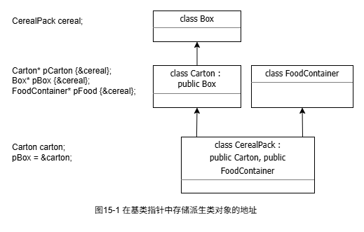
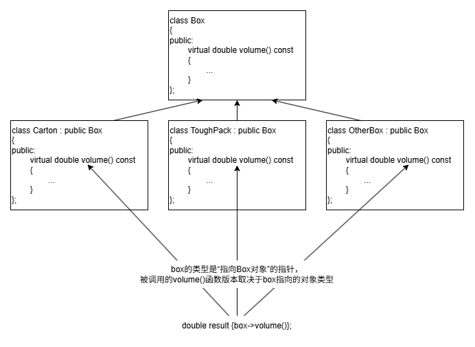

# 第15章 多态性

## 15.1 理解多态性

在C++中，多态性要在调用成员函数时使用对象的指针或引用。多态性仅用于共享一个公共基类的类层次结构。

### 15.1.1 使用基类指针

- 可以使用任何直接或间接基类的指针来存储派生类对象的地址，如下图

    

- 派生类对象总是包含每个基类的完整子对象，但每个基类只表示派生类对象的一部分

    ```cpp
    class Carton : public Box
    {
    public:
        double volume() const;
        //Details of the class...
    };

    class ToughPack : public Box
    {
    public:
        double volume() const;
        //Details of the class...
    };

    Carton carton {10.0, 10.0, 5.0};
    Box* box {&carton}; // 用carton地址初始化box指针

    ToughPack hardcase {12.0, 8.0, 4.0};
    box = &hardcase;    // 将hardcase的地址赋值给box指针
    ```

- `多态性：`box指针的类型Box*被称为静态类型，它也具有动态类型
    - 当box指向Carton对象时，其动态类型是“指向Carton对象的指针”
    - 当box指向ToughtPack对象时，其动态类型就是“指向ToughPack对象的指针”
    - 在box指向Box对象时，其动态类型就与静态类型相同
- 可以使用指针box调用基类和每个派生类中定义的函数。编译器会根据box的动态类型在运行期间选择调用哪个函数

    ```cpp
    double volume = box->volume();
    // 如果box指向Carton对象，就调用Carton对象的volume()函数；如果指向ToughPack对象，就调用ToughPack对象的volume()函数
    ```

### 15.1.2 调用继承的函数

- 案例Ex15-01
    - Ex15-01.cpp

        ```cpp
        // Ex15_01.cpp 派生类中继承函数的行为
        import boxes;

        int main()
        {
            Box box{20.0, 30.0, 40.0};
            ToughPack hardcase{20.0, 30.0, 40.0};

            box.showVolume();
            hardcase.showVolume();

            // 以下代码显示：如果 volume() 不是 virtual 的，通过基类指针调用只会调用基类的 volume()，而非派生类的。
            // std::cout<<"hardcase volume is "<<hardcase.volume()<<std::endl;
            // Box* box_pointer{&hardcase};
            // std::cout<<"hardcase volume through a Box* pointer is "
            //           <<box_pointer->volume()<<std::endl;
        }
        ```

    - Boxes.cppm

        ```cpp
        // Boxes.cppm 主模块接口文件
        export module boxes;

        // 导出全部分区
        export import :box;
        export import :tough_pack;
        ```

    - Box.cppm

        ```cpp
        // Box.cppm 基类
        export module boxes:box;

        import <iostream>;

        export class Box
        {
        public:
            Box() : Box{1.0, 1.0, 1.0} {}
            Box(double length, double width, double height)
                : m_length{length}, m_width{width}, m_height{height} {}

            void showVolume() const
            {
                std::cout << "Box usable volume is " << volume() << std::endl;
            }

            double volume() const { return m_length * m_width * m_height; }

        protected:
            double m_length, m_width, m_height;
        };
        ```

    - ToughPack.cppm

        ```cpp
        // ToughPack.cppm 派生类
        export module boxes:tough_pack;

        import :box;

        export class ToughPack : public Box
        {
        public:
            using Box::Box;

            double volume() const { return 0.85 * m_length * m_width * m_height; }
        };
        ```

        以上程序运行结果如下：

        ---

        ```cpp
        Box usable volume is 24000
        Box usable volume is 24000 
        ```

        ---

- 静态绑定（早绑定）：在编译阶段由编译器完成的函数调用绑定。编译器会根据「函数名、参数类型/个数、作用域」以及对象的静态类型（变量/表达式在编译时声明的固定类型），直接锁定要调用的函数版本，生成明确的机器码调用指令。
- 动态绑定（晚绑定）：在运行阶段才完成的函数调用绑定。仅当通过基类的指针/引用调用虚函数时触发——编译器不会提前锁定函数版本，而是通过运行时对象的动态类型（对象实际所属的类类型，即指针/引用当前绑定的真实派生类类型），结合C++虚函数表（vtable）机制，确定最终调用的虚函数版本。

### 15.1.3 虚函数

- 虚函数在基类中声明时使用限定符virtual，如下图：

    

- 使用对象调用虚函数总是进行静态解析，只有通过指针或引用调用虚函数才会进行动态解析
- 如果成员函数的定义在类定义的外部，就不能在函数定义中添加关键字virtual，这会产生错误
- 案例Ex15_02
